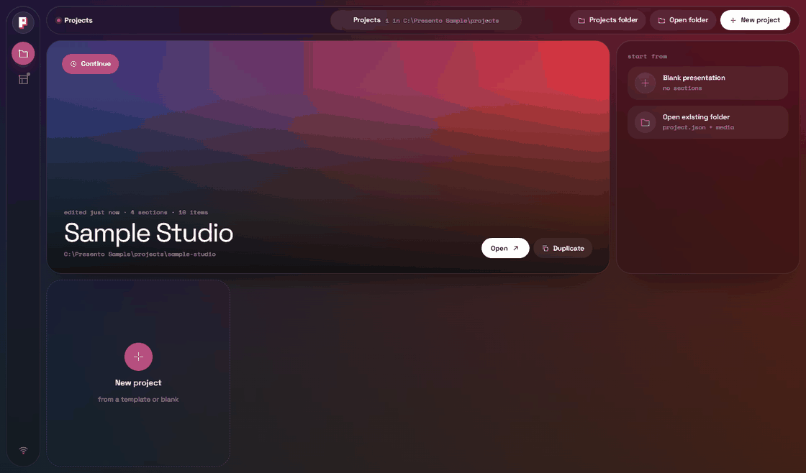
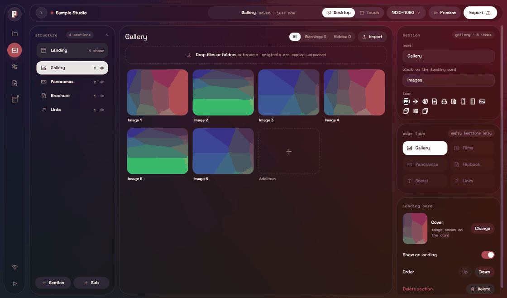
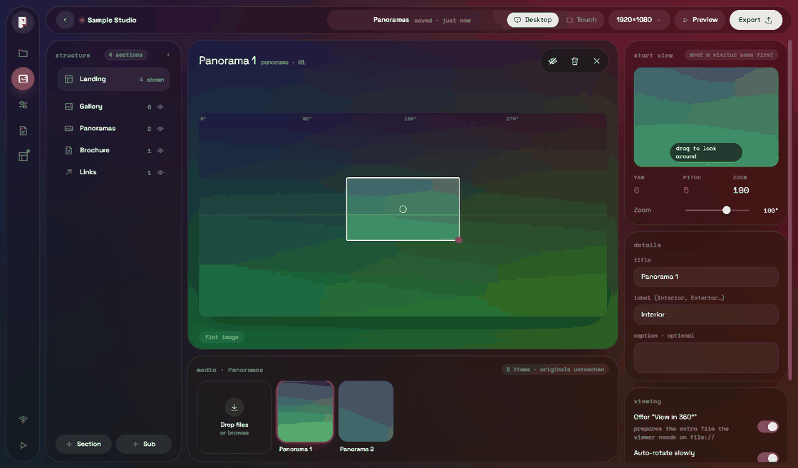
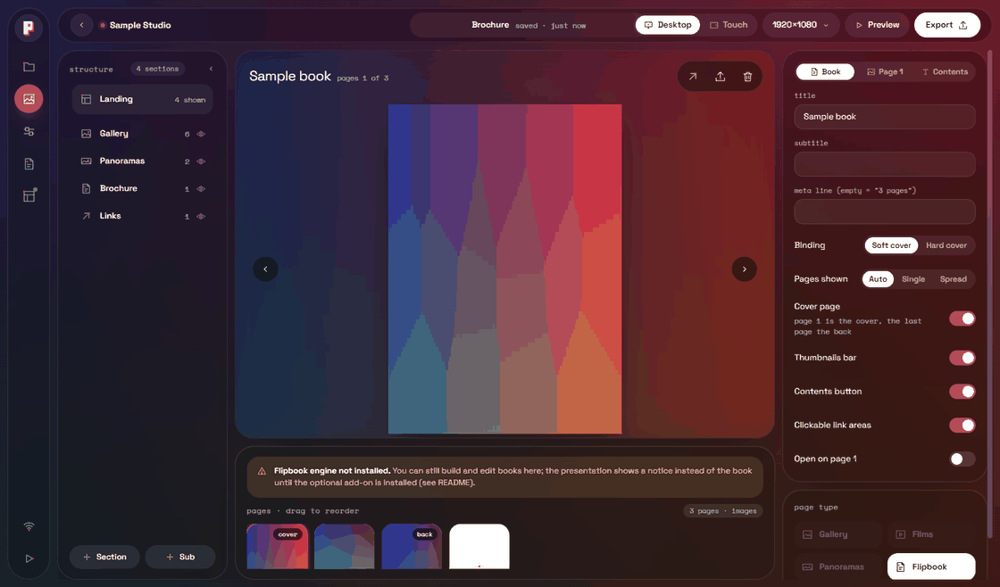
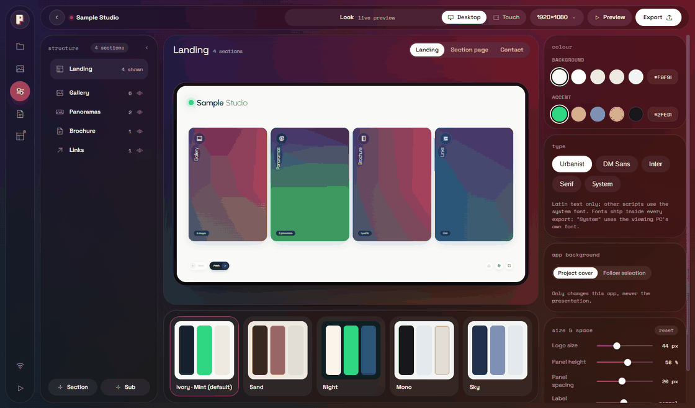
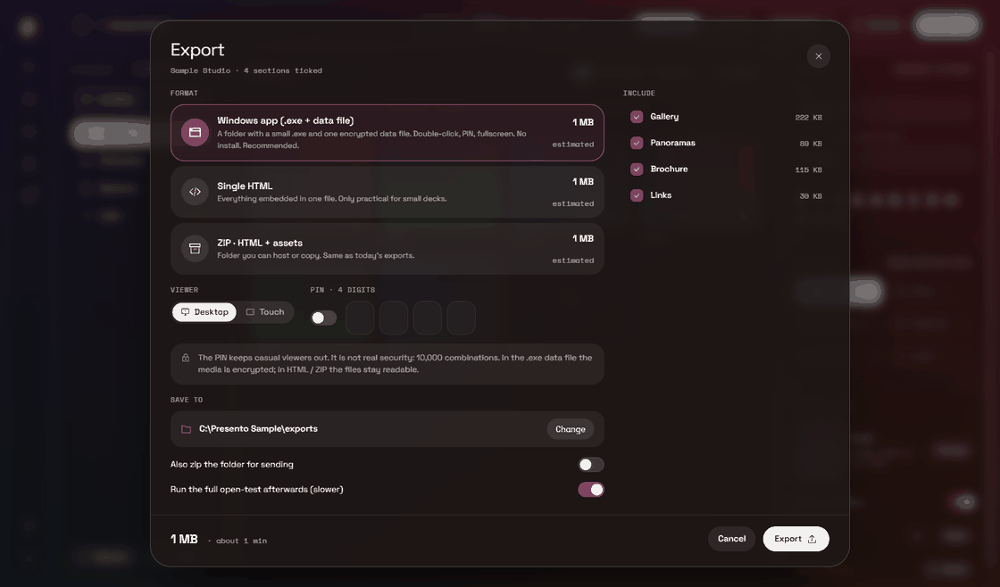

# Presento

**Build offline client presentations and hand them over as a single file or a small portable app.**

Presento is a Windows desktop app for studios and freelancers who show visual work (renders, films, panoramas, brochures, social mock-ups) to clients and need it to run anywhere: no internet, no installer on the client's PC, no quality loss. You assemble the presentation in a visual editor; Presento compiles it into a self-contained viewer and exports it as a ZIP, a single HTML file, or a `.exe` with an encrypted data file.

A project is a plain folder (`project.json` plus a `media/` folder), so it is easy to back up, duplicate and version.



## Features

- **Flexible structure**: unlimited sections and sub-sections, each with a page type: gallery, films, panoramas, flipbook, social mock-up or links. Drag to reorder, hide, rename, pick an icon.
- **Landing page for any number of sections**: one row up to five, two rows up to twelve, with Desktop and Touch viewers.
- **Media rules that protect quality**: files are copied byte-for-byte and MD5-verified; thumbnails and posters are separate files; TIF becomes lossless PNG; MP4/MOV get a lossless fast-start fix; unsupported files are reported, never silently dropped.
- **Editors**: video trim (playback only, no re-encode), lossless image crop, flipbook from PDF (300 dpi PNG pages, links and bookmarks kept), social/phone editor with live preview, panorama start-view editor, links inspector.
- **Look and settings**: colours (including a dark theme), fonts, panel size and spacing, button style, intro video, taglines, contact page, idle return.
- **Live preview** of the real viewer, and **network share** with a QR code and optional PIN.
- **Three exports** with an automatic post-export check (every file present and byte-identical, resolutions intact, opens without errors) and an optional 4-digit PIN gate:
  - ZIP: an HTML viewer plus an assets folder
  - single HTML file (everything embedded; warns above 300 MB, refuses above 1 GB)
  - portable app: a small WebView2 launcher plus one AES-encrypted data file, fullscreen kiosk, no install

| Content and media | Panorama editor |
|---|---|
|  |  |
| **Flipbook editor** | **Look and live preview** |
|  |  |



*The screenshots use generated placeholder images only (`tests/fixtures.js`).*

A 4-digit PIN keeps casual viewers out; it is not real security (10,000 combinations). In the portable app the media is encrypted; in the HTML and ZIP exports it stays readable.

## Repository layout

| folder | what |
|---|---|
| `app/` | the Electron app (renderer, main process, import, PDF and share code) |
| `core/` | project format, validation and the compiler (`project.json` to a viewer) |
| `runtime/` | the presentation viewer that ships inside every export |
| `exporters/` | ZIP, single HTML and portable exe exporters and the post-export checks |
| `launcher/` | the small WebView2 launcher used by the portable app |
| `tests/` | smoke tests built on generated fixtures |
| `docs/` | project format, exporters, editors, share and installer notes |
| `design/` | UI specs, logo files and the launch splash |

More detail: [`docs/PROJECT-FORMAT.md`](docs/PROJECT-FORMAT.md), [`docs/EXPORTERS.md`](docs/EXPORTERS.md), [`docs/EDITORS.md`](docs/EDITORS.md), [`docs/APP-SHARE-INSTALLER.md`](docs/APP-SHARE-INSTALLER.md).

## Build and run

Requirements: Windows 10/11 and Node.js 20 or newer. For the browser-driven checks also Chrome and [`uv`](https://docs.astral.sh/uv/) (Playwright is fetched by `uv run --with playwright`).

```
cd app
npm install
npm start                       # run the app
```

Tests:

```
node tests/smoke.js             # node only: fixture project, compile, ZIP and HTML export with their checks
uv run --with playwright python tests/app_smoke.py                    # drives the real app window
uv run --with playwright --with pillow python tests/screenshots.py    # regenerates docs/screenshots
```

### Portable app launcher

The launcher is C# for .NET Framework 4.x (part of Windows) and is compiled with the `csc.exe` that ships with Windows. It embeds Microsoft's WebView2 libraries, which are not stored in this repository: `launcher/fetch-webview2.js` downloads the official `Microsoft.Web.WebView2` NuGet package from nuget.org, and `launcher/build.js` runs it automatically when the libraries are missing.

```
node exporters/cli.js <projectFolder> exe --out <outputFolder> [--pin 1234] [--mode desktop|touch] [--zip]
```

### Other exports from the command line

```
node exporters/cli.js <projectFolder> zip|html --out <file> [--pin 1234] [--include a,b/c] [--no-browser]
```

### Windows installer

```
cd app
npm run dist                    # fetches WebView2, then electron-builder (NSIS, per user, no admin)
```

The installer is written to `app/dist/`. It is unsigned.

## Flipbook add-on (optional, not included)

The *flipbook* page type uses a separate page-turning engine (the Orbis flipbook engine) that is **not part of this repository**. Without it everything else works: books can still be built and edited in the app, and a presentation shows a "Flipbook engine not installed" notice instead of the book.

To enable it, put the add-on files in a folder with this layout:

```
flipbook/
  flipbook.js
  flipbook.css
  engine/
    book-template.js
    stage.js
```

and either place that folder at `runtime/addons/flipbook/` (installed app: `resources/runtime/addons/flipbook/`) or set the environment variable `PRESENTO_FLIPBOOK_ADDON` to its path. The compiler picks it up automatically.

## Contributing

Issues and pull requests are welcome.

1. Fork the repository and create a branch.
2. Run `cd app && npm install`, make your change, then run `node tests/smoke.js` (and `tests/app_smoke.py` if you touched the app) before opening a pull request.
3. Keep exports free of any app branding, and never re-encode, resize or modify a user's media: the byte-identical rule is a feature, and the post-export check enforces it.
4. Do not commit client or personal material: tests must use the generated fixtures in `tests/fixtures.js`, and paths must come from arguments or environment variables.
5. Describe what you tested and what you could not test.

## Licence

[MIT](LICENSE), copyright (c) 2026 aneeqx. Third-party components keep their own licences: Pannellum (MIT, `runtime/vendor/pannellum`), the fonts in `runtime/vendor/fonts` (SIL OFL 1.1, texts in `runtime/licenses`), Electron, pdf.js, and Microsoft WebView2 (fetched at build time under its own licence).
